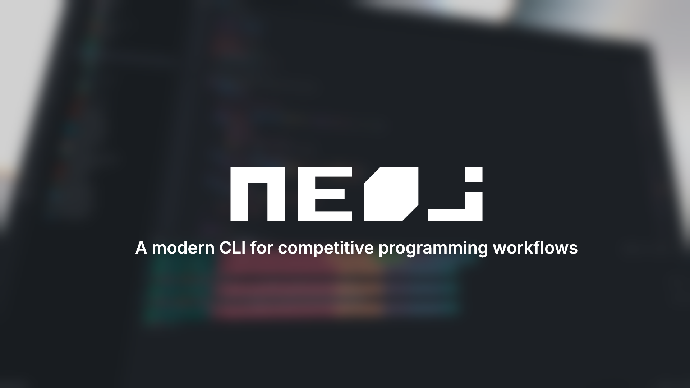

    

Built with Bun and TypeScript · Open Source

  
  
  
  

<strong>Early development</strong> — commands, configuration, and output formats may change between releases.

---

[English](README.md) | 日本語

`neoj` は、競技プログラミングの作業の流れを支えるコマンドラインツールです。[Bun](https://bun.com) とTypeScriptで作りました。`oj` の現代的な代替を目指しています。分かりやすいCLI、信頼できる問題の作業の流れ、競技プラットフォームに共通する一貫したインターフェースを備えます。

## ドキュメント

### 学ぶ

- [最初の問題](https://github.com/e6nlaq/neoj/blob/main/docs/ja/tutorial.md) —
  空のディレクトリから、サンプルテストのダウンロードまでを進めます。

### 実行する

- [neoj をインストールする](https://github.com/e6nlaq/neoj/blob/main/docs/ja/how-to/install.md)
- [シェル補完を設定する](https://github.com/e6nlaq/neoj/blob/main/docs/ja/how-to/setup-completions.md)
- [エディタ補完を設定する](https://github.com/e6nlaq/neoj/blob/main/docs/ja/how-to/setup-editor-completions.md)
- [ログイン、状態の確認、ログアウト](https://github.com/e6nlaq/neoj/blob/main/docs/ja/how-to/manage-sessions.md)
- [サンプルテストをダウンロードする](https://github.com/e6nlaq/neoj/blob/main/docs/ja/how-to/download-samples.md)
- [テストケースを手で作る](https://github.com/e6nlaq/neoj/blob/main/docs/ja/how-to/create-handmade-tests.md)
- [ランダムテストケースを生成する](https://github.com/e6nlaq/neoj/blob/main/docs/ja/how-to/generate-random-tests.md)
- [サンプルテストをビルドして実行する](https://github.com/e6nlaq/neoj/blob/main/docs/ja/how-to/run-tests.md)
- [テストなしで解法を実行する](https://github.com/e6nlaq/neoj/blob/main/docs/ja/how-to/run-a-solution.md)
- [解法を提出する](https://github.com/e6nlaq/neoj/blob/main/docs/ja/how-to/submit-solution.md)
- [作業を問題ごとに退避・復元する](https://github.com/e6nlaq/neoj/blob/main/docs/ja/how-to/stash-work.md)
- [プロジェクトを設定する](https://github.com/e6nlaq/neoj/blob/main/docs/ja/how-to/configure-project.md)
- [貢献する](https://github.com/e6nlaq/neoj/blob/main/docs/ja/how-to/contribute.md)

### 調べる

- [CLIリファレンス](https://github.com/e6nlaq/neoj/blob/main/docs/ja/reference/cli.md)
- [設定リファレンス](https://github.com/e6nlaq/neoj/blob/main/docs/ja/reference/configuration.md)
- [認証情報の保存](https://github.com/e6nlaq/neoj/blob/main/docs/ja/reference/credentials.md)

### 理解する

- [プラットフォームと統合](https://github.com/e6nlaq/neoj/blob/main/docs/ja/explanation/platforms.md)
- [セッションと認証情報の保護](https://github.com/e6nlaq/neoj/blob/main/docs/ja/explanation/sessions.md)

## 謝辞

`neoj` は、次のプロジェクトから影響を受け、学びました。

- [online-judge-tools/oj](https://github.com/online-judge-tools/oj) — `neoj` が現代化を目指す、元になった `oj` CLI。
- [sevenc-nanashi/competitive-programming-cli(cpg)](https://github.com/sevenc-nanashi/competitive-programming-cli) — 同じ分野を扱う競技プログラミングCLI。いくつかの発想の源になりました。

## ライセンス

[MIT](https://github.com/e6nlaq/neoj/blob/main/LICENSE)
