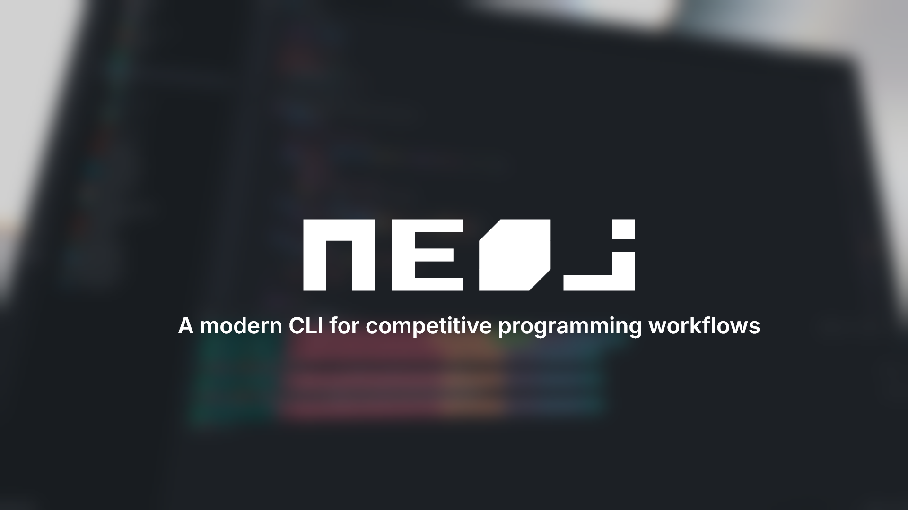

<div align="center">

<p align="center">
    
</p>

<p align="center"><sub>Built with Bun and TypeScript · Open Source</sub></p>

<p align="center">
  <a href="https://npmx.dev/package/@neoj/cli"></a>
  <a href="https://github.com/e6nlaq/neoj/blob/main/docs/how-to/install.md"></a>
  <a href="https://www.typescriptlang.org/"></a>
  <a href="https://github.com/e6nlaq/neoj/blob/main/LICENSE"></a>
</p>

<p align="center"><sub><strong>Early development</strong> — commands, configuration, and output formats may change between releases.</sub></p>

</div>

---

`neoj` is a command-line tool for competitive programming workflows, written in
TypeScript with [Bun](https://bun.com). The npm package starts a prebuilt binary
for Linux, macOS, and Windows, so you do not need Bun to use it. It aims to be a
modern alternative to `oj`: a clear CLI, a reliable problem workflow, and a
consistent interface across contest platforms.

## Install

```bash
npm install -g @neoj/cli
```

See [Install neoj](https://github.com/e6nlaq/neoj/blob/main/docs/how-to/install.md)
for standalone-binary instructions that skip the Node.js launcher.

## Supported services

| Service                 | Sample download (`download`) | Submit (`submit`) | Login / sessions (`login`, `status`) |
| ----------------------- | ---------------------------- | ----------------- | ------------------------------------ |
| Aizu Online Judge (AOJ) | ✅                           | —                 | —                                    |
| AtCoder                 | ✅                           | ✅                | ✅                                   |
| Codeforces              | ✅                           | —                 | —                                    |
| ShareOJ                 | ✅ (also contest problems)   | ✅                | ✅                                   |
| yukicoder               | ✅                           | ✅                | ✅                                   |

AOJ and Codeforces support is download-only for now: samples can be fetched,
but submissions and sessions are not implemented yet.

## API client

The platform integrations are also published as
[`@neoj/api`](https://www.npmjs.com/package/@neoj/api). It contains the HTTP
requests, URL validation, and parsing without the CLI:

```ts
import { YukicoderClient } from "@neoj/api/yukicoder";

const problem = await new YukicoderClient().getProblem("https://yukicoder.me/problems/no/480");
```

See the [API reference](https://github.com/e6nlaq/neoj/blob/main/docs/reference/api.md)
for the full surface, and [`packages/api/README.md`](packages/api/README.md) for
the package overview. The package is unofficial and is not affiliated with the
platforms it talks to; use it at your own risk.

## Documentation

### Learn

- [Your first problem](https://github.com/e6nlaq/neoj/blob/main/docs/tutorial.md) —
  go from an empty directory to downloaded sample tests.

### Do

- [Install neoj](https://github.com/e6nlaq/neoj/blob/main/docs/how-to/install.md)
- [Set up shell completions](https://github.com/e6nlaq/neoj/blob/main/docs/how-to/setup-completions.md)
- [Set up editor completions](https://github.com/e6nlaq/neoj/blob/main/docs/how-to/setup-editor-completions.md)
- [Log in, check status, and log out](https://github.com/e6nlaq/neoj/blob/main/docs/how-to/manage-sessions.md)
- [Download sample tests](https://github.com/e6nlaq/neoj/blob/main/docs/how-to/download-samples.md)
- [Create a test case by hand](https://github.com/e6nlaq/neoj/blob/main/docs/how-to/create-handmade-tests.md)
- [Generate random test cases](https://github.com/e6nlaq/neoj/blob/main/docs/how-to/generate-random-tests.md)
- [Build and run the sample tests](https://github.com/e6nlaq/neoj/blob/main/docs/how-to/run-tests.md)
- [Run a solution without tests](https://github.com/e6nlaq/neoj/blob/main/docs/how-to/run-a-solution.md)
- [Submit a solution](https://github.com/e6nlaq/neoj/blob/main/docs/how-to/submit-solution.md)
- [Stash and restore work per problem](https://github.com/e6nlaq/neoj/blob/main/docs/how-to/stash-work.md)
- [Configure a project](https://github.com/e6nlaq/neoj/blob/main/docs/how-to/configure-project.md)
- [Contribute (issues only)](https://github.com/e6nlaq/neoj/blob/main/CONTRIBUTING.md)

### Look up

- [CLI reference](https://github.com/e6nlaq/neoj/blob/main/docs/reference/cli.md)
- [API reference](https://github.com/e6nlaq/neoj/blob/main/docs/reference/api.md)
- [Configuration reference](https://github.com/e6nlaq/neoj/blob/main/docs/reference/configuration.md)
- [Credential storage](https://github.com/e6nlaq/neoj/blob/main/docs/reference/credentials.md)

### Understand

- [Platforms and integrations](https://github.com/e6nlaq/neoj/blob/main/docs/explanation/platforms.md)
- [Sessions and credential security](https://github.com/e6nlaq/neoj/blob/main/docs/explanation/sessions.md)

## Contributing

Contributions are accepted as **GitHub Issues only**. Pull requests are not
accepted and will be closed without review. Please use the issue templates for
bug reports and feature requests, or
[Discussions](https://github.com/e6nlaq/neoj/discussions) for questions.

See [CONTRIBUTING.md](https://github.com/e6nlaq/neoj/blob/main/CONTRIBUTING.md)
for details and local development instructions.

## Acknowledgements

`neoj` is inspired by, and learns from, these projects:

- [online-judge-tools/oj](https://github.com/online-judge-tools/oj) — the original `oj` CLI that `neoj` aims to modernize.
- [sevenc-nanashi/competitive-programming-cli(cpg)](https://github.com/sevenc-nanashi/competitive-programming-cli) — a competitive-programming CLI with a similar focus. Inspired by several ideas.

## License

[MIT](https://github.com/e6nlaq/neoj/blob/main/LICENSE)
